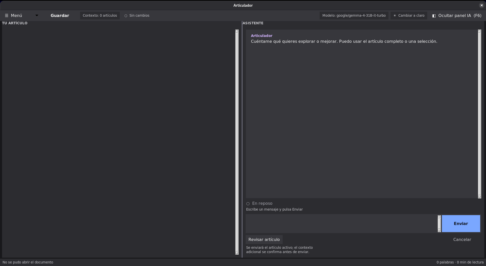

# Articulador

Editor conversacional local para escribir y revisar artículos Markdown con un LLM remoto opcional. La conversación es el espacio principal; el artículo permanece editable a la izquierda.



## Instalar sin Python

Para Linux x86_64 y Windows x86_64 se publican ejecutables standalone (sin Python instalado) en los Releases verificados por CI. macOS no es un target soportado actualmente. Ejecuta `--health` después de instalar.

## Ejecutar

```bash
python3 articulador.py
```

O, tras una instalación del paquete (`pip install -e .`), con el comando:

```bash
articulador
```

También puedes abrir un documento:

```bash
python3 articulador.py /ruta/articulo.md
```

Otras opciones de línea de comandos:

| Flag | Efecto |
|------|--------|
| `--config RUTA` | Usa un `config.toml` de perfiles LLM distinto del predeterminado. |
| `--health` | Imprime el diagnóstico de la instalación (config, logging, llavero) y sale, sin abrir la ventana. |

## Flujo

1. Escribe o abre un artículo. El menú **Recientes** guarda los últimos 10 documentos abiertos.
2. Conversa con Articulador en lenguaje natural; selecciona texto si quieres enfocar la consulta.
3. Usa **Revisar artículo** para una revisión de ortografía, gramática, semántica, redundancias y estructura.
4. Guarda el Markdown o un proyecto recuperable que conserva artículo y conversación.

El contexto local es explícito: puedes añadir artículos previos desde **Contexto de artículos…**. Se conservan al abrir otro artículo y, antes de enviarlos junto al artículo activo, Articulador pide confirmación de privacidad.

La conversación es por documento: cada artículo mantiene su propia hebra y se recupera al reabrirlo, incluso tras cerrar y volver a abrir Articulador.

## Atajos de teclado

| Atajo | Acción |
|-------|--------|
| `Ctrl+O` | Abrir artículo |
| `Ctrl+S` / `Ctrl+Mayús+S` | Guardar / Guardar como |
| `F6` | Mostrar u ocultar el panel del asistente |
| `F11` | Modo foco: oculta barra y pie, deja solo el artículo |
| `Ctrl+ +` / `Ctrl+ -` | Aumentar / reducir el zoom del texto |
| `Ctrl+0` | Restablecer el zoom al 100 % |
| `Esc` | Cancelar la consulta en curso |

## LLM y key

Abre **Configurar modelo…** (en el menú) para configurar el proveedor, endpoint, modelo y límites. Incluye plantillas para DeepInfra, DeepSeek, OpenRouter, Ollama, Anthropic, Gemini y cualquier API compatible con OpenAI. El selector no impide usar un endpoint personalizado.

La key puede mantenerse solo durante la sesión o recordarse en el llavero del sistema mediante `keyring`; nunca se escribe en el TOML ni en un JSON local. Una variable de entorno con el nombre configurado tiene prioridad. Para recordar la key:

```bash
pip install ".[keyring]"
```

## Diagnósticos y respaldo

Los diagnósticos técnicos se guardan en `~/.local/state/articulador/articulador.log`; no incluyen el artículo, la conversación ni API keys.

Los cambios sin guardar se respaldan automáticamente en `~/.local/state/articulador/autosave/` y se ofrecen para restaurar si la aplicación se cierra de forma inesperada.

El estado de interfaz (geometría de ventana, zoom, recientes y la conversación de cada documento) se guarda en `estado.json`, junto al `config.toml` de perfiles. Es local y de solo lectura defensiva: si se corrompe o no existe, Articulador arranca con los valores por defecto sin fallar.

## Calidad

Hay una sola puerta de calidad, espejo del pipeline de CI:

```bash
pip install -e ".[dev]"
./scripts/quality-gate.sh   # ruff + mypy + pytest con cobertura (mínimo 70 %)
```

## Roadmap (prototipo aislado, no integrado)

Articulador es hoy un editor de artículos; el contexto que usa proviene siempre
de archivos que el usuario elige explícitamente. Existe un prototipo aislado
de una fuente de contexto de amenazas, pero no está expuesto por la UI ni
forma parte del flujo funcional de esta versión. La evolución prevista hacia
generación de contenido de concientización en ciberseguridad (CVEs recientes
y su contexto) introduce una superficie nueva: red saliente iniciada por
Articulador mismo, no solo por acción directa del usuario hacia el proveedor
LLM. Detalle de diseño en
[ARCHITECTURE.md § Evolución planeada](docs/ARCHITECTURE.md#evolución-planeada-fuente-de-contexto-de-amenazas-cve)
y el impacto de seguridad en
[SECURITY.md § Superficie planeada](docs/SECURITY.md#superficie-planeada-fuente-de-amenazas-cve).
El prototipo y sus pruebas no constituyen una capacidad comprometida ni una
garantía de integración; se mantienen aislados hasta completar la revisión de
seguridad, UI y aceptación correspondiente.

## Documentación

Consulta el [índice documental](docs/README.md), que enlaza arquitectura,
seguridad, privacidad, configuración, operaciones, testing, releases y
trazabilidad. La seguridad de las API keys depende del endpoint, proveedor,
variable de entorno o keyring que configure el usuario; revisa
[SECURITY.md](docs/SECURITY.md) antes de enviar contenido sensible.
