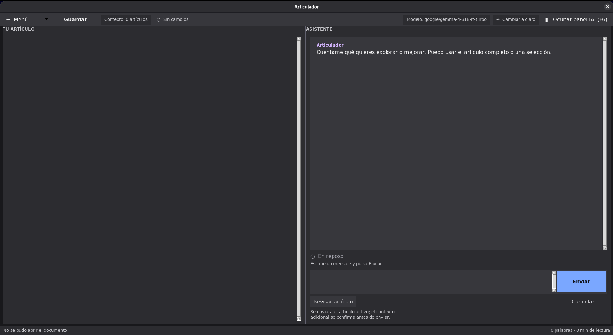

# Tukul

Editor conversacional local para escribir y revisar artículos Markdown con un LLM remoto opcional. La conversación es el espacio principal; el artículo permanece editable a la izquierda.



## Instalar sin Python

Para Linux x86_64 y Windows x86_64 se publican ejecutables standalone (sin Python instalado) en los Releases verificados por CI. macOS no es un target soportado actualmente. Ejecuta `--health` después de instalar.

## Ejecutar

```bash
python3 tukul.py
```

O, tras una instalación del paquete (`pip install -e .`), con el comando:

```bash
tukul
```

También puedes abrir un documento:

```bash
python3 tukul.py /ruta/articulo.md
```

Otras opciones de línea de comandos:

| Flag | Efecto |
|------|--------|
| `--config RUTA` | Usa un `config.toml` de perfiles LLM distinto del predeterminado. |
| `--health` | Imprime el diagnóstico de la instalación (config, logging, llavero) y sale, sin abrir la ventana. |

## Flujo

1. Escribe o abre un artículo. El menú **Recientes** guarda los últimos 10 documentos abiertos.
2. Conversa con Tukul en lenguaje natural; selecciona texto si quieres enfocar la consulta.
3. Usa **Revisar artículo** para una revisión de ortografía, gramática, semántica, redundancias y estructura.
4. Guarda el Markdown o un proyecto recuperable que conserva artículo y conversación.

El contexto local es explícito: puedes añadir artículos previos desde **Contexto de artículos…**. Se conservan al abrir otro artículo y, antes de enviarlos junto al artículo activo, Tukul pide confirmación de privacidad.

La conversación es por documento: cada artículo mantiene su propia hebra y se recupera al reabrirlo, incluso tras cerrar y volver a abrir Tukul.

## Atajos de teclado

| Atajo | Acción |
|-------|--------|
| `Ctrl+O` | Abrir artículo |
| `Ctrl+S` / `Ctrl+Mayús+S` | Guardar / Guardar como |
| `F6` | Mostrar u ocultar el panel del asistente |
| `F11` | Modo foco: oculta barra y pie, deja solo el artículo |
| `Ctrl+ +` / `Ctrl+ -` | Aumentar / reducir el zoom del texto |
| `Ctrl+0` | Restablecer el zoom al 100 % |
| `Esc` | Cancelar la consulta en curso |

## LLM y key

Abre **Configurar modelo…** (en el menú) para configurar el proveedor, endpoint, modelo y límites. Incluye plantillas para DeepInfra, DeepSeek, OpenRouter, Ollama, Anthropic, Gemini y cualquier API compatible con OpenAI. El selector no impide usar un endpoint personalizado.

La key puede mantenerse solo durante la sesión o recordarse en el llavero del sistema mediante `keyring`; nunca se escribe en el TOML ni en un JSON local. Una variable de entorno con el nombre configurado tiene prioridad. Para recordar la key:

```bash
pip install ".[keyring]"
```

## Diagnósticos y respaldo

Los diagnósticos técnicos se guardan en `~/.local/state/tukul/tukul.log`; no incluyen el artículo, la conversación ni API keys.

Los cambios sin guardar se respaldan automáticamente en `~/.local/state/tukul/autosave/` y se ofrecen para restaurar si la aplicación se cierra de forma inesperada.

El estado de interfaz (geometría de ventana, zoom, recientes y la conversación de cada documento) se guarda en `estado.json`, junto al `config.toml` de perfiles. Es local y de solo lectura defensiva: si se corrompe o no existe, Tukul arranca con los valores por defecto sin fallar.

## Calidad

Hay una sola puerta de calidad, espejo del pipeline de CI:

```bash
pip install -e ".[dev]"
./scripts/quality-gate.sh   # ruff + mypy + pytest con cobertura (mínimo 70 %)
```

## Contexto de amenazas (CVE)

Además de artículos de archivo, el contexto puede incluir un resumen de CVEs
recientes: en el diálogo "Contexto de artículos", el botón **"Añadir CVEs
recientes…"** consulta tres fuentes públicas (NVD, EPSS de FIRST.org y el
catálogo CISA KEV) y añade el resumen como contexto autorizado. Es una conexión
saliente iniciada por la aplicación —no por el proveedor LLM—, siempre tras una
acción explícita y una confirmación; nunca automática ni periódica. El resultado
se trata como dato no confiable y pasa por la aprobación de contexto como
cualquier otro artículo. Detalle en
[ARCHITECTURE.md](docs/ARCHITECTURE.md#fuente-de-contexto-de-amenazas-cve)
y el impacto de seguridad en
[SECURITY.md](docs/SECURITY.md#superficie-fuente-de-amenazas-cve).

## Documentación

Consulta el [índice documental](docs/README.md), que enlaza arquitectura,
seguridad, privacidad, configuración, operaciones, testing, releases y
trazabilidad. La seguridad de las API keys depende del endpoint, proveedor,
variable de entorno o keyring que configure el usuario; revisa
[SECURITY.md](docs/SECURITY.md) antes de enviar contenido sensible.
