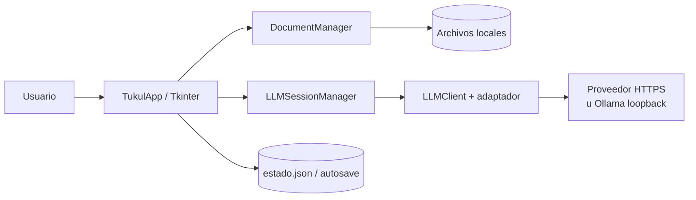

# Arquitectura actual

## Propósito y contexto

Tukul es un editor local de artículos Markdown con una interfaz Tkinter y una integración opcional con modelos de lenguaje remotos. El artículo, la conversación por documento, la configuración y los logs se gestionan localmente; solo el prompt enviado por una acción del usuario cruza el límite del proveedor configurado.



Actores: usuario local, proveedor LLM configurado y sistema operativo/servicios de credenciales. El boundary del producto es el proceso Tukul y sus archivos de estado; el proveedor, el keyring y la red son externos. No hay servidor propio ni base de datos.

## Componentes y contratos

| Componente | Responsibility | Inputs / outputs | State ownership | Dependencies | Failure modes |
|---|---|---|---|---|---|
| `TukulApp` | Coordina UI, documento, conversación, requests y cierre | eventos Tk; cambios visuales y mensajes | sesión UI, `RequestState`, ámbito del documento | Tkinter, managers, storage | error de UI, request cancelada, config inválida |
| `DocumentManager` | Abre/guarda Markdown y proyectos recuperables | rutas y `ArticleSession`; archivos | sesión del artículo | `storage.atomic_write` | ruta ilegible, tamaño excedido, proyecto inválido |
| `LLMSessionManager` | Orquesta prompt, streaming, callbacks y cancelación | perfil, key, contexto; chunks/control | request en curso | `LLMClient`, prompting | límite de respuesta, error del proveedor |
| `LLMClient` | HTTP, adaptadores y parsing de respuestas | `LlmProfile`, prompt; `LlmResponse`/chunks | conexiones activas por request ID | `urllib`, proveedor | timeout, HTTP, JSON/SSE malformado |
| `ChunkBuffer` | Coalesce de texto sin bloquear la cola de control | fragmentos; texto agrupado | buffer protegido por lock | threading | texto pendiente descartado al cancelar |
| `control_queue` | Entrega de `complete`/`error` | eventos de ciclo de vida | propiedad de la UI | `queue.Queue` | evento malformado, manejador defectuoso |
| Adaptadores de proveedor | Traducen OpenAI-compatible, Anthropic y Gemini | prompt/key; protocolo externo | ninguno persistente | HTTP | respuesta incompatible |
| `storage` | Config, estado UI, credenciales, proyectos y escritura atómica | TOML/JSON/rutas | archivos locales y keyring | filesystem, `tomli-w`, keyring opcional | corrupción, permisos, keyring no disponible |
| `autosave` | Respaldo periódico del artículo sucio | ruta/contenido; `.md` | archivo en estado del usuario | storage | directorio no escribible |
| `logging_config` | Log JSON rotativo y consola | eventos internos | handlers y archivos rotativos | logging | destino no escribible |
| `health` | Diagnóstico sin abrir la ventana | ruta config; `HealthStatus` | ninguno | storage/logging | aviso o error de almacenamiento |

## Request lifecycle y concurrencia

La UI construye el prompt con artículo, paquete de contexto aprobado y conversación; estima límites; asigna un request ID y crea un `threading.Event` de cancelación. El worker ejecuta el cliente y publica chunks en `ChunkBuffer`; al terminar publica exactamente un evento de control. Tkinter procesa ambos desde su hilo mediante `after(50, ...)`. Un request tardío se ignora mediante el ID/estado vigente y no puede aplicar datos a otro documento.

El texto puede agruparse, pero no se descarta mientras la petición esté activa. La finalización se drena después de pintar los chunks pendientes. El detalle de ordering, ownership y shutdown está en [QUEUE_POLICY.md](QUEUE_POLICY.md).

## Persistencia, recuperación y configuración

Los artículos y proyectos se escriben con reemplazo atómico. El proyecto JSON contiene versión, ruta relativa del artículo y hasta 30 mensajes. `config.toml` contiene perfiles; `estado.json` contiene geometría, zoom, recientes y conversaciones por documento. El autosave se escribe cada 5 segundos mientras el artículo está sucio y se limpia al guardar o cerrar explícitamente. La configuración canónica está en [CONFIGURATION.md](CONFIGURATION.md); datos y retención en [DATA_AND_PRIVACY.md](DATA_AND_PRIVACY.md).

## Red, seguridad y errores

Los endpoints aceptan HTTPS y HTTP únicamente para `localhost`, `127.0.0.1` o `::1`. No se siguen redirects en requests autenticadas. API keys se obtienen de la variable configurada, de una key de sesión o del keyring; no se serializan en TOML/JSON. El contenido de artículos, contexto y respuestas se trata como input no confiable para el prompt. La amenaza residual y los límites están en [SECURITY.md](SECURITY.md).

Los errores de configuración se degradan a perfiles defensivos/default; los errores de red y parsing llegan a la UI como error de la petición. `--health` separa warnings de errores y devuelve código 1 solo si existe un componente roto.

## Fuente de contexto de amenazas (CVE)

Estado: **implementado.** `tukul_core/threat_feed.py` construye el
contexto; `TukulApp` lo expone en el diálogo "Contexto de artículos" con
el botón **"Añadir CVEs recientes…"**. `tests/test_threat_feed.py` cubre el core
y `tests/test_threat_feed_ui.py` la integración. La fila correspondiente sigue en
la sección "superficie" de `SECURITY.md` hasta que haya cobertura end-to-end con
la ventana real montada; los controles descritos ahí ya están en el código.

Objetivo: generar contenido de concientización en ciberseguridad (artículos
sobre CVEs recientes) reutilizando el editor y el flujo de LLM existentes, sin
rediseñar el core.

```mermaid
flowchart LR
  UI[Botón "Añadir CVEs recientes…"<br/>diálogo de contexto] -->|acción explícita| TF[threat_feed<br/>hilo daemon]
  TF -->|fetch NVD/EPSS/KEV| NET[Red saliente<br/>iniciada por la app]
  TF -->|normaliza a texto| CTX[Instantánea de contexto]
  CTX --> CA[ContextApprovalCache<br/>existente]
  CA -->|aprobado| LS[LLMSessionManager<br/>existente]
```

Decisiones de diseño:

- **Reutiliza `ContextApprovalCache` tal cual.** El resultado de `threat_feed`
  entra como un `ContextArticle` más (`source_id` fijo
  `threat-feed:cve-recientes`, así un re-fetch reemplaza en vez de duplicar) y
  se aprueba por huella antes de llegar al prompt — mismo mecanismo que los
  artículos de contexto manuales, sin cambios de API. `build_threat_context`
  devuelve `(packet, files)` con esa forma.
- **No reutiliza el supuesto de red actual.** El resto de la red saliente
  ocurre por una acción del usuario hacia el proveedor LLM. `threat_feed`
  consulta NVD/EPSS/CISA KEV por iniciativa de Tukul, pero solo desde el
  botón del diálogo (acción explícita, con confirmación previa) y en un hilo
  daemon; nunca automático ni periódico. Es una superficie nueva; ver
  `SECURITY.md`.
- **Nuevo módulo de core, sin cambios a `storage`/`llm`/`review`.** Vive
  aislado en `tukul_core/threat_feed.py` con sus propios tests.
  `LLMSessionManager` y `prompting.py` se reutilizan sin tocar. El transporte
  HTTP comparte el guard anti-redirect de `llm.py` vía
  `tukul_core.http_safety`.
- **Fuentes:** NVD API v2 (`services.nvd.nist.gov`, sin key para uso básico),
  EPSS (FIRST.org, sin key), CISA KEV (catálogo público). Las tres son
  gratuitas; la NVD API tiene reportes de inestabilidad en la comunidad, por lo
  que `ThreatFeed` lleva reintentos/timeout explícitos con jitter desde el
  diseño inicial. Ninguna fuente es indispensable: si una falla, el contexto se
  degrada; solo si fallan las tres se propaga `ThreatFeedError`.

## Shutdown y calidad

`destroy()` cancela/espera con tope los hilos de `review()` y `request()` antes de destruir la ventana. Los workers son daemon, pero el cierre normal intenta terminarlos. La calidad se define por [TESTING.md](TESTING.md), y el workflow de CI y build-release son la autoridad de ejecución y targets.
