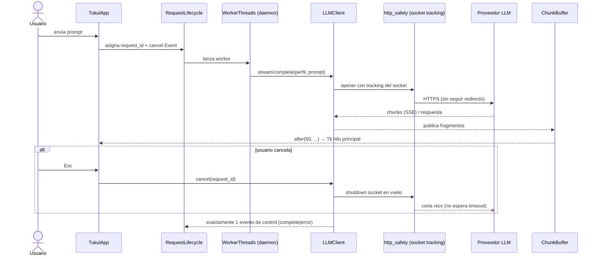
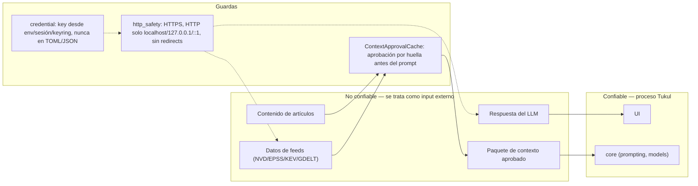
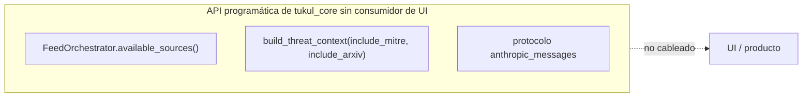

# Diagrama de arquitectura — Tukul

> Artefacto de apoyo para revisión por un especialista. **Fuente primaria:** el
> código en `tukul_core/` y `tukul_ui/` (commit `d02753f`, rama `master`),
> contrastado con `docs/ARCHITECTURE.md`, `README.md` y `docs/decisions/ADR-*.md`.
> Notación: C4 (contexto + contenedores) + una vista de runtime del ciclo de
> request. Render: Mermaid (source-backed, embebible en docs y CI).

## 1. Contexto del sistema (C4 nivel 1)

```mermaid
flowchart LR
  U(["Usuario local"])
  subgraph BOUNDARY["Límite del producto: proceso Tukul (sin servidor propio, sin BD)"]
    TUKUL["Tukul<br/>app de escritorio"]
  end
  subgraph EXTERNAL["Servicios externos (fuera del límite)"]
    PROVIDER["Proveedor LLM<br/>HTTPS · OpenAI-compat / DeepInfra / Novita"]
    NVD["NVD API v2"]
    EPSS["FIRST EPSS"]
    KEV["CISA KEV"]
    GDELT["GDELT"]
    KEYRING["Keyring del SO"]
    FS["Sistema de archivos local"]
  end
  U --> TUKUL
  TUKUL -->|"prompt del usuario<br/>(solo acción explícita)"| PROVIDER
  TUKUL -->|"CVE: acción explícita"| NVD
  TUKUL --> EPSS
  TUKUL --> KEV
  TUKUL -->|"búsqueda de contexto"| GDELT
  TUKUL <-->|"credenciales"| KEYRING
  TUKUL <-->|"artículos, estado, autosave, caché"| FS
```

**Lectura:** el boundary es el proceso Tukul y sus archivos de estado. Toda
salida a red (proveedor o feeds) nace de una **acción explícita del usuario**;
nunca es automática ni periódica (ADR-0003).

## 2. Contenedores / capas (C4 nivel 2)

```mermaid
flowchart TB
  subgraph UI["Capa UI — tukul_ui (Tkinter, hilo principal)"]
    APP["TukulApp<br/>orquestador"]
    SHELL["WindowShell"]
    PANELS["components/<br/>EditorPanel · AssistantPanel · TopBar"]
    DIALOGS["dialogs · contexto_dialogo · ideas"]
    CTRL["ContextController · IdeasController"]
    APPROVAL["ContextApprovalCache"]
    CREDS["CredentialStore"]
    REQLIFE["RequestLifecycle"]
    WORKERS["WorkerThreads"]
    CBUF["ChunkBuffer"]
    SCOPE["DocumentScope · estado.EstadoUI"]
    ESTILO["tema · estilo · ventana"]
  end

  subgraph CORE["Núcleo — tukul_core (sin dependencias de UI)"]
    DOCMGR["DocumentManager"]
    LSESS["LLMSessionManager"]
    LLM["LLMClient + adaptadores"]
    REVIEW["review"]
    PROMPT["prompting · prompts · models"]
    MEMORY["memory/<br/>CorpusIndex · MemoryPolicy · FileMemoryRepository"]
    SEARCH["search/<br/>SearchOrchestrator · providers (GDELT)"]
    RTF["real_time_feed/<br/>FeedOrchestrator · normalizer · cache"]
    THREAT["threat_feed"]
    IMPACT["impact_analyzer<br/>CorrelationEngine · IdeaGenerator"]
    STORAGE["storage<br/>config.toml · estado.json · atómico"]
    AUTOSAVE["autosave"]
    HTTP["http_safety<br/>NO_REDIRECT · socket tracking"]
    HEALTH["health · logging_config · config_validator · version"]
  end

  subgraph DATA["Estado local (disco / keyring)"]
    ART[(Artículos .md)]
    PROJ[(Proyectos JSON)]
    CFG[(config.toml)]
    STJ[(estado.json)]
    CACHE[(feed_cache · autosave)]
    KR[(Keyring)]
  end

  APP --> SHELL --> PANELS
  APP --> DIALOGS --> CTRL
  CTRL --> APPROVAL
  APP --> DOCMGR --> STORAGE
  APP --> LSESS --> LLM
  APP --> REQLIFE --> WORKERS --> LLM
  LLM --> CBUF
  CTRL --> MEMORY
  CTRL --> SEARCH
  CTRL --> THREAT
  CTRL --> RTF
  CTRL --> IMPACT
  DOCMGR --> AUTOSAVE
  LSESS --> PROMPT
  APP --> REVIEW
  APP --> CREDS
  APP --> SCOPE
  APP --> ESTILO
  CREDS --> KR
  MEMORY --> ART
  STORAGE --> CFG
  STORAGE --> STJ
  STORAGE --> PROJ
  AUTOSAVE --> CACHE
  RTF --> CACHE
  MEMORY --> CACHE
  LLM --> HTTP
  THREAT --> HTTP
  RTF --> HTTP
  SEARCH --> HTTP
  HEALTH --> STORAGE
```

**Invariante de capas (verificado):** `tukul_ui → tukul_core` es unidireccional.
`grep "from tukul_ui\|import tukul_ui"` sobre `tukul_core/` no devuelve nada.

## 3. Runtime — ciclo de request y cancelación

**Invariantes de runtime:** la UI es dueña de `complete`/`error` vía
`control_queue`; un request tardío se descarta por `request_id` vigente y no
puede escribir en otro documento (QUEUE_POLICY.md, ADR-0002).

## 4. Boundary de red y confianza

## 5. Superficies documentadas pero NO consumidas por la UI (ADR-0004)

---

## Artefactos renderizados

SVG validados con `@mermaid-js/mermaid-cli` 12.2.0 (render real, no solo
sintaxis):

| Vista | Fuente (Mermaid) | SVG |
|---|---|---|
| Contexto (C4 L1) | §1 | `assets/architecture/tukul_diag_1.svg` |
| Contenedores (C4 L2) | §2 | `assets/architecture/tukul_diag_2.svg` (+ `contenedores.png`) |
| Runtime request | §3 | `assets/architecture/tukul_diag_3.svg` |
| Boundary de red | §4 | `assets/architecture/tukul_diag_4.svg` |
| API sin consumidor | §5 | `assets/architecture/tukul_diag_5.svg` |

---

## Notas de trazabilidad (para el revisor)

**Observado en código (citas):**
- Capas unidireccionales: `tukul_ui/app.py:15-57` importa `tukul_core/*`;
  `grep` inverso en `tukul_core/` = vacío.
- `memory` y `search` **sí** tienen consumidor de UI, ausente en
  `docs/ARCHITECTURE.md`: `tukul_ui/contexto_dialogo.py:28-29,368`
  (`SearchOrchestrator().search()`), `:26` (memory); `app.py:24,1617-1620`
  (`CorpusIndex`).
- Proveedores registrados: `tukul_core/llm.py:69-71` (openai_compatible,
  deepinfra, novita).
- Fuentes de feed: `real_time_feed/orchestrator.py:83-92` (nvd/epss/kev);
  `search/providers.py:55` (GDELT).
- Guarda de red: `tukul_core/http_safety.py:26,36,124` (no-redirect, tracking).
- Estado local: `tukul_core/storage.py:33` (`~/.config/tukul/config.toml`),
  `:76` (`estado.json`).

**Inferido (no confirmado en fuente primaria) — `[REQUIERE CONFIRMACIÓN]`:**
- La topología exacta de `memory → feed_cache` como almacén compartido: el
  corpus vive bajo `memory_root` (por defecto `~/Articulos`,
  `app.py:235-238`); `feed_cache` es `~/.local/state/tukul/feed_cache`
  (ARCHITECTURE.md:73-74). En el diagrama se agrupan como "estado local" pero su
  convivencia como misma capa es **inferencia de agrupación**, no un mismo
  directorio.

**Divergencias detectadas respecto de `docs/ARCHITECTURE.md`:**
- El Mermaid de ARCHITECTURE.md (L8-16) omite `memory/`, `search/`,
  `RequestLifecycle`, `WindowShell`, `ContextApprovalCache` y
  `config_validator`, todos presentes en código y al menos uno con consumidor
  real de UI. **Es una observación, no un veredicto de obsolescencia**: el doc
  declara el subsistema de feeds/ideas (ADR-0003) pero no el de memoria/búsqueda
  de contexto.
